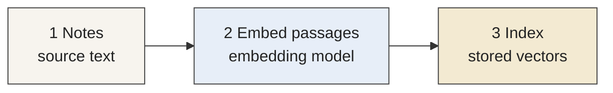
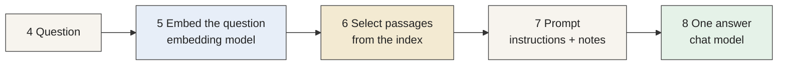
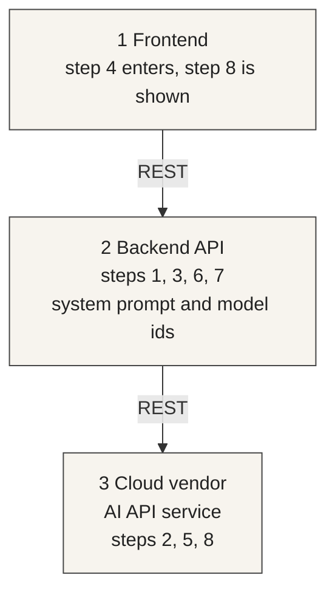



# Weeks 4–5: Exercise 2 (15 points)

[Slides (PDF)](/slides/exercise-2.pdf)

## GenAI application adaptation and improvement

Sessions: {{ site.session_4_date }} and {{ site.session_5_date }}.

Exercise 2 starts after the [Exercise 1](/exercise-1) deadline. [Exercise 3](/exercise-3) starts on the second of these two sessions. See the [schedule](/schedule).

{: .note }

> By {{ site.exercise_2_baseline_deadline }}: deploy the ready application and commit the baseline answer. Setup can take time. The prompt stays unchanged.

{: .highlight }

> Modification deadline: {{ site.exercise_2_deadline }}. Change the required paragraph in your own words, ask the question again, and commit the comparison.

The application is a wine-quality study assistant. It answers questions from a fixed set of notes about the same wine data as [Exercise 1](/exercise-1): what each laboratory measurement means, how the `quality` score is defined, and short notes on example wines. You deploy the ready application on your own CSC Rahti project, open it with a password you choose for this deployment, record one baseline answer, change the required paragraph in your own words, and compare the two answers. The route rejects a chat request that does not have that password.

The assistant explains the notes and cites them. It does not estimate a quality score.

### An AI system

An AI system is software combined with AI.

Regular software components are a backend, a database, an optional frontend, and REST APIs.

AI adds components of its own: system prompts, a vector database, tools, configuration such as chunk sizes in RAG, and MCP interfaces.

This exercise is RAG, and it executes deterministically. The steps run in a fixed order. Retrieval is context enrichment: the question selects notes from the index, those notes are written into the prompt, and the model generates one answer. A later exercise executes dynamically. That system reaches a broader set of capabilities through tools, including the quality model from Exercise 1.

### How a large model works

A large model turns its input, such as text, into an embedding: a vector of numbers. It works on those vectors and produces new ones. The new vectors are turned back into the original form, such as text.

The index in this application stores the note vectors. The question is embedded with the same model, and the nearest note vectors are the passages written into the prompt.

### How an answer is made

The first path runs when the application starts. The second path runs for each question and reads that index.

**Before a question**



**For each question**



- **Notes** hold the source text.
- **Embedding** turns a passage, and the question, into vectors.
- **Index** stores the passage vectors and returns the nearest ones.
- **Prompt** holds the instructions and the selected notes.
- **Chat model** generates one answer.

Steps 1–3 run when the application starts. Steps 4–8 run for each question.

### Where the steps live



1. **Frontend.** The chat page. The question enters here, and the answer is shown here.
2. **Backend API.** The notes, the index, passage selection, and the prompt. The system prompt and the model ids live here. Steps 3 and 6 use the index kept in this process.
3. **Cloud vendor AI API service.** The embedding model and the chat model, called over REST. This term that service is CSC Aitta, at `{{ site.exercise_2_aitta_base_url }}`. A later term can use another vendor.

Tools and MCP interfaces belong to the later exercise.

Step-by-step commands are in the [GenAI application](/genai-application) guide.

### Deployment password

Choose a password for this deployment. Use a password you do not use anywhere else. Store it in the Rahti secret `exercise-2-access` before the deployments are applied.

Email that same password to {{ site.email }}. The subject is `For exercise 2 check`. Do not commit the password, and do not put it in `deployment.txt`. Open the site with the password you chose. If you change it, email the value that is running.

{: .note }

> Slide source: `slidev/exercise-2.md`.

### Learning focus

- AI system concepts
- Retrieval as context enrichment
- Structured outputs
- Prompt engineering
- Evaluation and iteration

### Repository

The repository is [{{ site.exercise_1_github_org }}/{{ site.exercise_2_repo_name }}](https://github.com/{{ site.exercise_1_github_org }}/{{ site.exercise_2_repo_name }}). `{{ site.exercise_2_base_branch }}` is the ready application. Create `{{ site.exercise_2_branch }}` from it. Replace `<id>` with the personal id from week 1. Do not commit on `{{ site.exercise_2_base_branch }}`. A push there overwrites the shared application. The commands are in the [GenAI application](/genai-application) guide.

The chat model is `{{ site.exercise_2_chat_model }}`. The embedding model is `{{ site.exercise_2_embedding_model }}`. Leave both ids as they are.

### Baseline, by {{ site.exercise_2_baseline_deadline }}

1. Deploy the ready application and open the chat.
2. Ask the fixed question and save the baseline answer.
3. On `{{ site.exercise_2_branch }}`, commit `BASELINE.md`, `deployment.txt`, and `baseline-answer.md`, and push that branch. The prompt does not yet contain the required paragraph.

### Modification, by {{ site.exercise_2_deadline }}

1. Change the required paragraph in your own words and put that wording into the prompt.
2. Ask the same question again and save the modified answer.
3. Compare the two answers. They should differ, because the prompts differ.

Fixed question:

```text
{{ site.exercise_2_fixed_question }}
```

Required paragraph. This is a starting point, not the text to deploy. Change it in your own words, then put your wording into `CUSTOM_RAG_PROMPT` in `{{ site.exercise_2_prompt_file }}` after the baseline commit. The file must not contain this paragraph unchanged. Leave the two model ids unchanged. Your wording is what makes the second answer differ from the baseline.

{: .note }

> The changed prompt has to be your own original version. A copy of another student's prompt is not allowed. The 4 points for the required modification require that original version.

```text
{{ site.exercise_2_required_prompt }}
```

Baseline marker. Put this sentence alone in `BASELINE.md` on the baseline commit, while the prompt file does not yet contain the required paragraph:

```text
{{ site.exercise_2_baseline_marker }}
```

### Files to commit

| File | What it contains |
| --- | --- |
| `BASELINE.md` | The baseline marker |
| `deployment.txt` | One line, the `https://` URL of your route, with no path |
| `baseline-answer.md` | The fixed question and the baseline reply |
| `{{ site.exercise_2_prompt_file }}` | Your own wording of the required paragraph, not the paragraph unchanged |
| `modified-answer.md` | The fixed question and the reply after the change |
| `comparison.md` | A short comparison that names the baseline answer and the modified answer |

`deployment.txt` looks like this, with your own host:

```text
https://exercise-2-web-your-project.2.rahtiapp.fi
```

### Grading (15 points)

| Criterion | Points |
| --- | ---: |
| Baseline execution completed | 3 |
| Required modification implemented | 4 |
| Modified execution completed | 3 |
| Required outputs generated | 3 |
| Baseline and modified results compared | 2 |
| **Total** | **15** |

The 4 points for the required modification require a prompt you wrote yourself. A copy of another student's prompt does not receive those points.

### How to submit

Push the branch `{{ site.exercise_2_branch }}` on `{{ site.exercise_2_repo_name }}`. Do not push `{{ site.exercise_2_base_branch }}`. The push runs `{{ site.exercise_2_workflow }}`. That workflow checks the branch. It does not call the model. The answer files are the execution traces.

Do not commit the API token or the password you chose.
