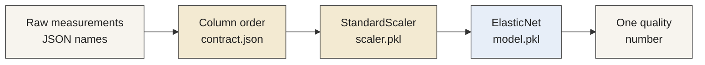
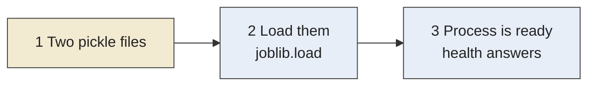
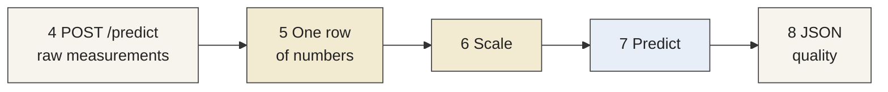
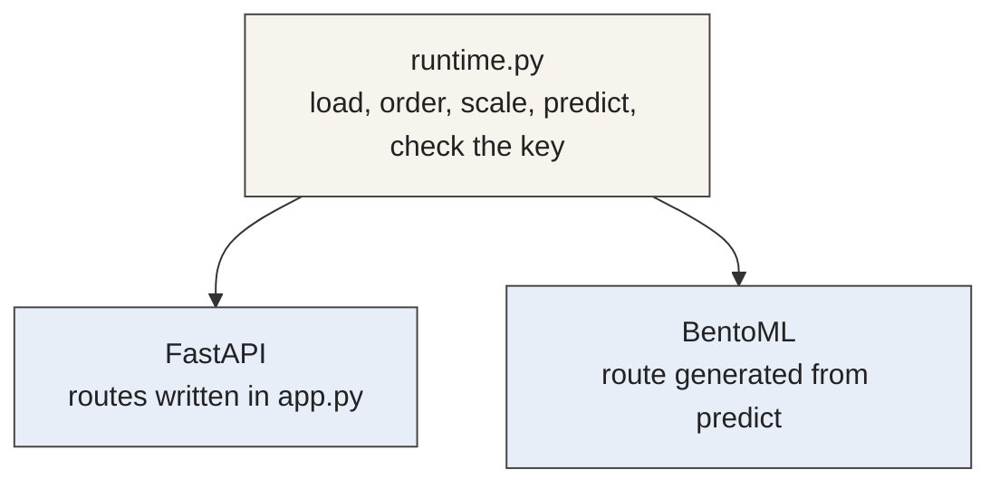
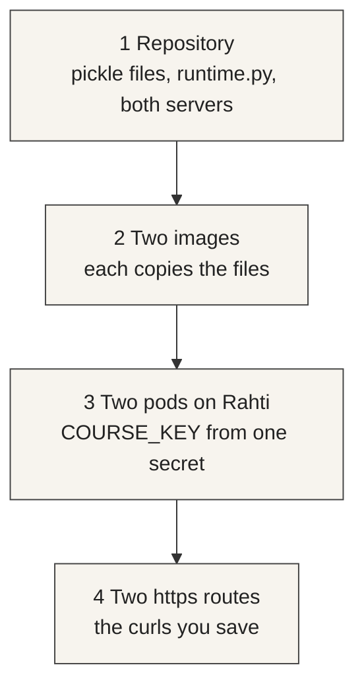



# Week 5: Exercise 3 (20 points)

[Slides (PDF)](/slides/exercise-3.pdf)

[Model deployment guide](/model-deployment)

## Model deployment

Session: {{ site.session_5_date }}. Exercise 2's prompt change is due the same evening. See the [schedule](/schedule).

{: .highlight }

> Submission deadline: {{ site.exercise_3_deadline }}.

{: .note }

> Preview. This page is omitted from the public site until it is removed from `unpublished_pages`. Slide source: `slidev/exercise-3.md`.

Deploy the Exercise 1 baseline model twice, on your own CSC Rahti project, and show that both servers return the same quality score for one request. One server is a small FastAPI application. The other is the same wrapper behind BentoML. The builds are local uploads, as in Exercise 2. A push checks the branch. It leaves the cluster alone.

Exercise 4 will call the FastAPI service from the Exercise 2 application. Leave that deployment running.

### From a training run to a service

Exercise 1 ran a pipeline. The pipeline downloaded the red-wine table, scaled the laboratory columns, fit an `ElasticNet(alpha=0.5, l1_ratio=0.5)`, and stored metrics in MLflow. When that run finished, the pipeline stopped.

A deployed model is the saved result of a run, kept available so a new measurement can be scored without training again. The service loads the files when the process starts and then waits. Each prediction is one request.

### What was saved

`ElasticNet.predict` maps one row of numbers to one quality number. Saving the fitted model writes that function, with the coefficients from training, into `model/model.pkl`.

The row the model expects is not the raw laboratory sheet. Exercise 1 fit a `StandardScaler` on the training columns and then fit the regressor on the scaled numbers. The regressor file holds the coefficients. The scaler file, `model/scaler.pkl`, holds the means and the scales. A prediction repeats both steps, in that order: scale the raw numbers, then call `predict`.

The two files already in the template are a stand-in, so the folder is complete before yours are copied in. Replace both with the files from your own week 2 run, the first Exercise 1 run, before you changed the pipeline. The week 3 run may have dropped a measurement or skipped scaling, so it is not the pair you deploy.

Kubeflow and MLflow list every student's runs together. Open yours by the git commit of that week 2 push, not by browsing the list. On your `exercise-1-<id>` branch, that commit is the one from `git rev-parse HEAD` after the week 2 push. The Kubeflow run name ends with your branch and the first 7 characters of that commit. In MLflow the same commit is the parameter `git_commit_hash`.

With the [week 1 tunnel](/week-1#ssh-tunnel-to-the-oss-mlops-platform) open, copy the scaling file from the preprocess step of that run to `model/scaler.pkl`, and the model file from the train step of that same run to `model/model.pkl`. Commit them. The servers install scikit-learn 1.0.2, the version that saved those files.

A model file is often too large to keep in a git repository. MLflow stores those files in separate storage, such as S3, and the git commit only records which run produced them. These two files are small, so this exercise commits them. The branch can then be built as it is, and the committed files can be compared with the run that saved them.

The columns have an order. `contract.json` records the order the scaler saw. A request names each measurement in JSON. The server reads those names and builds one list of numbers in the saved order. The model receives the list. It does not receive the names.



### How a score is made

The first path runs when the process starts. The second path runs for each request and uses the objects already in memory.

**When the process starts**



**For each request**



- **The pickle files** are the scaler and the fitted regressor.
- **Loading** turns those files back into objects. This happens once.
- **The row** is the request body, rearranged into the column order.
- **Scale** applies the training means and scales to that row.
- **Predict** returns one number. The response is that number under the name `quality`.

Steps 1–3 run at startup. Steps 4–8 run for each call to `POST /predict`.

`GET` health does not score anything. It only tells you the process is up. FastAPI answers `GET /health`. BentoML brings its own probe, `GET /healthz`.

### Two ways to publish the same wrapper

The scoring steps live in `runtime.py`. Both servers call that file. The difference is who publishes HTTP.

An application server is code you write. FastAPI declares `GET /health` and `POST /predict`. Uvicorn runs that application. You can read every route in `fastapi_server/app.py`.

A serving framework publishes the service from a smaller description. BentoML reads the `predict` method in `bentoml_server/service.py` and serves it as `POST /predict`. The framework also opens `GET /healthz`. The method still calls `runtime.py` for the score.



The same request body is sent to both routes. The quality numbers should match, because both processes loaded the same two files and ran the same four functions.

### Where the steps live



1. **Repository.** The model files, the wrapper, and the two server programs. You fill in the four functions in `runtime.py`.
2. **Images.** Each Dockerfile copies `runtime.py` and both pickle files into the image. That copy is what puts the model on the server.
3. **Pods.** One process per server, in the Rahti project from Exercise 2. Both read `COURSE_KEY` from the secret `exercise-3-access`.
4. **Routes.** The public `https` addresses. `deployment.txt` records them. Inside the project, Exercise 4 will call the FastAPI service at `http://exercise-3-fastapi:8000`.

`POST /predict` asks for the header `{{ site.exercise_3_key_header }}`. Health stays open.

Step-by-step commands are in the [model deployment](/model-deployment) guide.

### Learning focus

- A saved model and the preprocess step that has to travel with it
- Load once, then score each request
- An application server and a serving framework around one wrapper
- A prediction route a later tool can call

### What you write

The repository is [{{ site.exercise_1_github_org }}/{{ site.exercise_3_repo_name }}](https://github.com/{{ site.exercise_1_github_org }}/{{ site.exercise_3_repo_name }}). `{{ site.exercise_3_base_branch }}` is the shared template. Create `{{ site.exercise_3_branch }}` from it. Replace `<id>` with the personal id from week 1. Do not commit on `{{ site.exercise_3_base_branch }}`.

`runtime.py` has four functions that still raise `NotImplementedError`. Fill them in with the bodies in the [model deployment guide](/model-deployment):

1. `load_artifacts` loads the two pickle files when the process starts.
2. `features_in_order` builds one row of numbers from the JSON names, in `contract.json` order.
3. `quality_from_row` scales that row and returns one float from `model.predict`.
4. `require_course_key` compares the `{{ site.exercise_3_key_header }}` header with the `COURSE_KEY` environment variable.

`fastapi_server/app.py` and `bentoml_server/service.py` already call those functions. Read both files before the build. FastAPI publishes `GET /health` and `POST /predict`. BentoML publishes `POST /predict` from the `predict` method, and its own probe is `GET /healthz`.

### Course key

Choose a key for this deployment. Use a key you do not use anywhere else. Store it in the Rahti secret `exercise-3-access` before the deployments are applied. Both deployments read `COURSE_KEY` from that secret.

Email that same key to {{ site.email }}. The subject is `For exercise 3 check`. Do not commit the key, and do not put it in `deployment.txt`.

`GET` health stays open. `POST /predict` without the header is rejected.

### Deploy and compare

Use the Rahti project from Exercise 2. Step-by-step commands are in the [model deployment guide](/model-deployment).

Send `request.json` to both routes with the header. Save the bodies as `response-fastapi.json` and `response-bentoml.json`. The quality numbers should match.

`deployment.txt` has two lines, each an `https://` URL with no path:

```text
fastapi https://exercise-3-fastapi-your-project.2.rahtiapp.fi
bentoml https://exercise-3-bentoml-your-project.2.rahtiapp.fi
```

`comparison.md` names both quality numbers.

### Files to commit

| File | What it contains |
| --- | --- |
| `model/scaler.pkl` | The scaling file from your week 2 run, the run named with your branch and that commit |
| `model/model.pkl` | The model file from that same run |
| `runtime.py` | The four functions filled in, with no `NotImplementedError` left |
| `deployment.txt` | Two lines, `fastapi` and `bentoml`, each an `https://` URL with no path |
| `response-fastapi.json` | The prediction body from the FastAPI route |
| `response-bentoml.json` | The prediction body from the BentoML route |
| `comparison.md` | Both quality numbers |

### How to submit

Push the branch `{{ site.exercise_3_branch }}` on `{{ site.exercise_3_repo_name }}` by {{ site.exercise_3_deadline }}. Do not push `{{ site.exercise_3_base_branch }}`. The push runs `{{ site.exercise_3_workflow }}`. That workflow checks the branch. It does not deploy and it does not call the model. The response files are the execution traces. The running routes are checked with the key you emailed.

Do not commit the key.

### Grading (20 points)

| Criterion | Points |
| --- | ---: |
| Model artifact available | 3 |
| Deployment configuration completed | 5 |
| Model successfully deployed | 5 |
| Successful prediction request | 4 |
| Successful prediction response | 3 |
| **Total** | **20** |

The artifact points require both files from your own week 2 run, the one named with your branch and that commit, committed on the branch in place of the template stand-in. The deployment points cover the secret, both manifests, and both builds. The request and response points require both routes to return the score those committed files produce for `request.json`.
