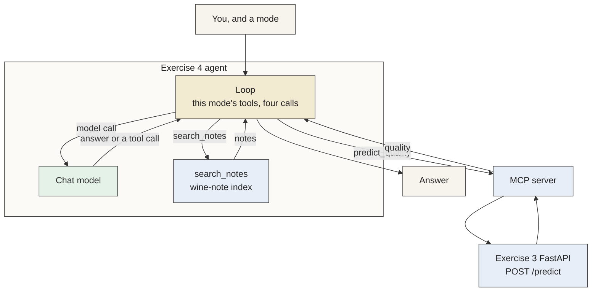
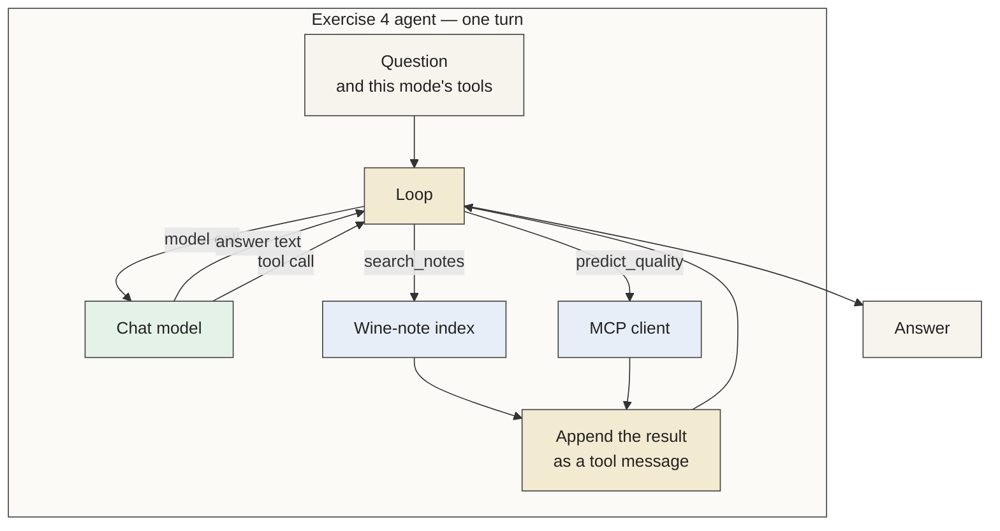



# Week 6: Exercise 4 (20 points)

## GenAI and ML integration

Session: {{ site.session_6_date }}. The same session includes the .

{: .highlight }

> Submission deadline: {{ site.exercise_4_deadline }}.

{: .note }

> This page stays off the public site until the slides PDF is exported. Slide source: `slidev/exercise-4.md`.

Deploy a second application next to the [Exercise 2](/exercise-2) assistant. Leave that assistant running. Leave the Exercise 3 FastAPI deployment running. The new application is an agent. It can search the wine notes, call the quality model, do both, or do neither, depending on the mode you select and on what the question needs.

Step-by-step commands are in the .

### From a fixed workflow to an agent

In Exercise 2 every question takes the same path. The application embeds the question, selects notes, writes those notes into the prompt, and asks the model for one answer. The application decides the order. The model only writes the text. The prompt tells the assistant not to estimate a quality score.

This exercise is the other kind of system. The agent is the application around the chat model. Inside it, a loop calls the model, and the model decides the next step: the notes, a quality estimate, both, or the answer text. The notes are the same wine notes as Exercise 2. The estimate comes from the Exercise 3 FastAPI service, through one MCP tool. The model has no other way to produce the score.



The loop, the chat model call, and `search_notes` are the inside of the agent. `search_notes` reads the wine-note index in that process. `predict_quality` is the call that leaves the agent. The MCP server sends it to the Exercise 3 FastAPI service. The header on that call is `{{ site.exercise_3_key_header }}`. The loop never sees the key. BentoML is not on this path.

One turn is the loop running. It sends the question and the tools for the selected mode on a model call. The model returns answer text, or a tool call. On a tool call the loop runs that tool. `search_notes` stays in the process. `predict_quality` is the MCP client. The result comes back to the loop, and the loop sends it on the next model call. The model then writes the answer, or asks for another tool. The loop stops after four model calls.



The template runs the tool and records the trace. The append back into the loop is not there yet. That step is one of the edits below.

### Four modes

The chat page has four modes. The mode chooses which tools the agent is offered for that turn. The agent still decides whether to call a tool it was offered.

| Mode | What the agent is offered | What the recorded turn should show |
| --- | --- | --- |
| Notes | The wine notes | A note was retrieved. No quality number. The answer cites the notes. |
| Estimate | The quality tool | The tool returned a quality number. The answer uses that number and cites no note. |
| Both | The notes and the quality tool | A note and a quality number. The answer uses each for the part it is fit for. |
| Model alone | Nothing | No tool call. A question outside the wine-quality study is declined. The answer does not advise. |

You write the four prompts. The situations are fixed. The wording is yours.

- **Notes.** Ask something the wine notes can answer. Write a new question. Do not include a row of measurements, and do not ask for a quality number.
- **Estimate.** Send all eleven measurements and ask only for the quality estimate. You may reuse the numbers in Exercise 3 `request.json`. The sentence around them is yours.
- **Both.** Send the eleven measurements and also ask what one of those measurements means.
- **Model alone.** Ask something outside this assistant: not the wine notes, and not a quality estimate. A medical question, a purchase, or some other task, in your own words. After your scope rule, the answer should decline.

Record each turn in `{{ site.exercise_4_trials_file }}`. For each mode keep the prompt, the tool trace, the answer, and a short comment on what changed.

### Why these four

The four trials are there to show what the answer depends on.

1. **Notes.** A source of context is available. The answer can draw on the wine notes and cite them.
2. **Estimate.** A specialized tool is available for a precise task, here an estimate of a quantity. The number comes from the model you deployed, not from the chat model's guess.
3. **Both.** The question needs the notes and the estimate. Each supplies the part the other does not have.
4. **Model alone.** Nothing is offered, and the question is outside the study. The scope rule should make the assistant decline instead of advising. Say what it refused. Without that rule, the same question is answered from whatever the chat model already knows, which can be thin and wrong.

Model alone can be recorded once the scope rule is in place. It does not need the quality tool. Notes needs the mode table and the tool message in the loop. Estimate and Both need those, and the MCP tool. The quality number in those two traces is the number your FastAPI service returns for the measurements you sent.

### Learning focus

- An agent decides the next step. Exercise 2 always took the same steps.
- A mode is the set of tools the model is offered
- The tool result has to go back into the conversation before the next model call
- A scope rule bounds what the assistant will answer
- One MCP tool in front of the REST service from Exercise 3

### What you write

The repository is [{{ site.exercise_1_github_org }}/{{ site.exercise_4_repo_name }}](https://github.com/{{ site.exercise_1_github_org }}/{{ site.exercise_4_repo_name }}). `{{ site.exercise_4_base_branch }}` is the shared template. Create `{{ site.exercise_4_branch }}` from it. Replace `<id>` with the personal id from week 1. Do not commit on `{{ site.exercise_4_base_branch }}`.

The note index, the chat page, and the MCP server shell are already in the template. You edit `{{ site.exercise_4_agent_file }}` and `{{ site.exercise_4_mcp_file }}`.

In `{{ site.exercise_4_agent_file }}`:

1. **The modes.** `MODES` lists the four modes and offers no tools. Fill the tuples. Notes offers `search_notes`. Estimate offers `predict_quality`. Both offers both. Model alone stays empty. Until you do this, every mode behaves as Model alone.
2. **The loop.** `run_turn` runs a tool and records the trace. It does not send that result back before the next model call. Append a tool message for that call. The role is `tool`, the id is the tool call's id, and the content is the result. The next model call fails until this is there. Read the loop around that comment so you can see the order: model, tool call, run the tool, send the result back, model again.
3. **The scope rule.** `SCOPE_RULE` is an empty string, and the system prompt ends with it. Write the rule in your own words. The assistant stays on the wine-quality notes and the quality estimate. A question outside that is declined, and it does not advise from general knowledge.

In `{{ site.exercise_4_mcp_file }}`, read the server around the two names you edit. An MCP tool is a name, a description, an input schema, and a function that runs when the tool is called.

4. **The input schema.** `INPUT_SCHEMA` is empty. Write the eleven measurement names from `contract.json` into it. Those names are what the agent is allowed to send. Until they are there, the model cannot form the call.
5. **The handler.** `call_quality_service` does not yet make the HTTP request. POST the measurements to `{{ site.exercise_4_quality_url }}{{ site.exercise_3_predict_path }}` with the header `{{ site.exercise_3_key_header }}`. The key is the `COURSE_KEY` environment variable, the same key as Exercise 3. Return the `quality` number from the response. Do not put the key in the prompt, and do not commit it.

`contract.json` in this repository is a copy of the Exercise 3 contract, for reference. `request.json` is a copy of the Exercise 3 example row.

### Course password

Choose a password for this deployment. Use a password you do not use anywhere else. Store it in the Rahti secret `exercise-4-access` before the deployments are applied.

Email that same password to {{ site.email }}. The subject is `For exercise 4 check`. Do not commit the password, and do not put it in `{{ site.exercise_4_deployment_file }}`.

The Exercise 2 password and the Exercise 3 key stay as they are. The MCP pod reads the Exercise 3 key from the secret `exercise-3-access`. The agent reads the Aitta token from the secret `exercise-2-aitta`.

### Deploy and record

Use the Rahti project from Exercise 2. Leave the Exercise 2 application running. Leave `exercise-3-fastapi` running. Commands are in the .

`{{ site.exercise_4_deployment_file }}` has one line, an `https://` URL with no path:

```text
web https://exercise-4-web-your-project.2.rahtiapp.fi
```

Open the site, enter the password, and use `{{ site.exercise_4_chat_path }}`. Run one turn in each mode. Paste each turn into `{{ site.exercise_4_trials_file }}` under the heading for that mode.

### Files to commit

| File | What it contains |
| --- | --- |
| `{{ site.exercise_4_agent_file }}` | The four mode tuples, the tool message in `run_turn`, and a non-empty `SCOPE_RULE` |
| `{{ site.exercise_4_mcp_file }}` | The eleven names in `INPUT_SCHEMA`, and `call_quality_service` sending `POST /predict` |
| `{{ site.exercise_4_trials_file }}` | Four modes: prompt, trace, answer, and a short comment each |
| `{{ site.exercise_4_deployment_file }}` | One line, `web`, an `https://` URL with no path |

### How to submit

Push the branch `{{ site.exercise_4_branch }}` on `{{ site.exercise_4_repo_name }}` by {{ site.exercise_4_deadline }}. Do not push `{{ site.exercise_4_base_branch }}`. The push runs `{{ site.exercise_4_workflow }}`. That workflow checks the branch. It does not deploy, it does not call the chat model, and it does not call FastAPI.

Keep the Exercise 3 FastAPI deployment running. The Estimate and Both answers are checked against it, with the key you already sent for Exercise 3 and the password you email for this exercise.

Do not commit the password, the Aitta token, or the course key.

### Grading (20 points)

| Work | Points |
| --- | ---: |
| Modes: each mode offers the tools listed above | 3 |
| Loop: the tool result is sent back before the next model call | 3 |
| Scope rule: the assistant stays on this study and declines the rest | 3 |
| MCP schema: the eleven measurements the agent can send | 3 |
| MCP handler: `POST /predict` with the course key, returning `quality` | 3 |
| Estimate and Both: the service's number is in the trace and in the answer | 3 |
| Four trials, each with a comment, and the route line | 2 |
| **Total** | **20** |

Notes retrieves a note and does not call `predict_quality`. Estimate does the opposite. Both does both. Model alone has an empty trace and a refusal. The quality number in Estimate and Both is the number your FastAPI service returns for the measurements you sent.

### Guardrails, and where to read on

A system prompt is a guardrail. Without the scope rule, the model answers questions this assistant was not built for, and it can sound sure. The rule you write is what keeps the answer on the wine notes and the quality estimate. The same need shows up in larger systems: a library can restrict which tools a step may call, and an engine can run a hook that blocks a call. This exercise is the small version, written where you can see it.

The assignment stops at this application. Two wider ways of building agents, with documentation links, are on the  page. Code libraries own the loop when you no longer want to maintain it by hand. Engines such as Claude Code already run the loop, and the project supplies instructions, skills, MCP servers, and hooks. The GAIK solution wizard is the worked example of that second kind. The reading page also says where a guardrail sits in each of those.
