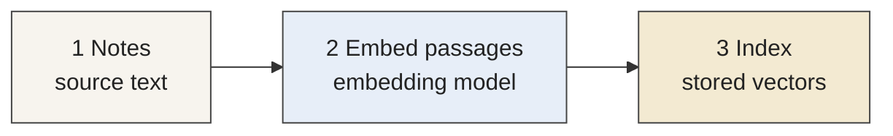
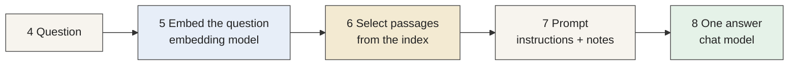
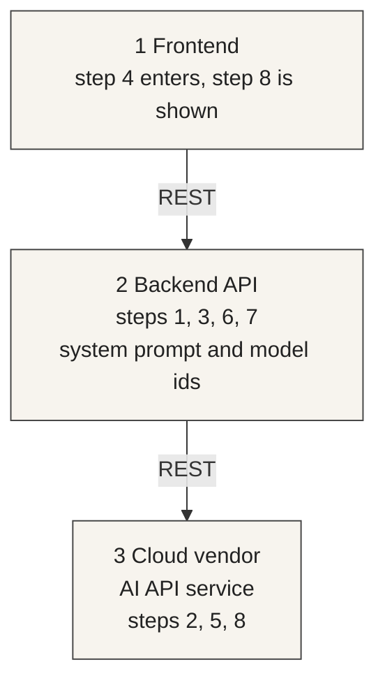

# Exercise 2

GenAI application adaptation and improvement — 15 points

Sessions {{ site.session_4_date }} and {{ site.session_5_date }}.

Baseline due {{ site.exercise_2_baseline_deadline }}. The prompt change is due {{ site.exercise_2_deadline }}. Exercise 3 starts on {{ site.session_5_date }}.

---

## Learning focus

- AI system concepts
- Retrieval as context enrichment
- Structured outputs
- Prompt engineering
- Evaluation and iteration

---

## An AI system

An AI system is software combined with AI.

Regular software components:

- Backend
- Database
- Optional frontend
- REST APIs

AI adds components of its own:

- System prompts
- A vector database
- Tools
- Configuration, such as chunk sizes in RAG
- MCP interfaces

---

## Deterministic, then dynamic

This exercise is RAG, and it executes deterministically. The steps run in a fixed order. The question selects notes, those notes are written into the prompt, and the model generates one answer.

A later exercise executes dynamically. The system reaches a broader set of capabilities through tools.

---

## How a large model works

A large model turns its input, such as text, into an embedding: a vector of numbers.

It works on those vectors and produces new ones.

The new vectors are turned back into the original form, such as text.

The index in this exercise stores the note vectors. The question is embedded with the same model, and the nearest note vectors are the passages written into the prompt.

---

## Retrieval enriches the prompt

A chat model writes from the prompt it is given.

The question selects notes from the index. Those notes are written into the prompt. The model then generates one answer.

The notes and both models stay as shipped. You change the prompt, ask the same question again, and compare the two answers.

---

## Roles

- Notes hold the source text
- The embedding model turns a passage, or the question, into a vector
- The index stores the passage vectors and returns the nearest passages
- The prompt holds the instructions and the selected notes
- The chat model generates one answer from that prompt

---

## The path

The first path runs when the application starts. The second path runs for each question and reads that index.

**Before a question**

**For each question**

---

## Where the steps live

Steps 3 and 6 use the index kept in the backend process. Tools and MCP interfaces belong to the later exercise.

---

## What you keep

The baseline commit has the original prompt. The later commit adds one paragraph.

Keep the route URL, the answer from each commit, and a comparison that names both answers.

A citation names the note and the section the question selected.

---

## What you run

A ready wine-quality study assistant.

The notes cover the Exercise 1 measurements, the sensory `quality` score, and a few example wines.

The answer cites a note. It does not estimate a quality score.

---

## Where it runs

Your own CSC Rahti project. Two containers, no database.

Follow the Haaga-Helia CSC pages for the account, the project, `oc`, a private repository, and debugging.

The course guide supplies the manifests, the API token secret, and the route.

---

## Your branch

Clone {{ site.exercise_2_repo_name }}.

Create `exercise-2-<id>` from {{ site.exercise_2_base_branch }} and push that branch.

Do not commit on {{ site.exercise_2_base_branch }}. That branch is the ready application, shared by the class.

---

## Deployment password

Choose a password for this deployment. Use one you do not use anywhere else.

Store it in the secret `exercise-2-access` before the deployments are applied.

Email that same password to {{ site.email }}.

Subject: For exercise 2 check.

Do not commit it, and do not put it in `deployment.txt`. Open the site with the password you chose.

If you change it, email the value that is running.

---

## Models

Chat: `google/gemma-4-31b-it`

Embeddings: `lightonai/modernbert-embed-large`

Base URL this term: `https://aitta-api.csc.fi/openai/v1` (CSC Aitta).

Leave both ids unchanged. The first question can wait while the cloud vendor AI API service loads the chat model.

---

## Fixed question

What does residual sugar measure, and is it the same thing as the quality score?

Ask it once before the edit. Ask it again after the edit.

---

## Baseline

`BASELINE.md` contains:

Baseline run. Prompt and model settings are unchanged.

Also commit `deployment.txt` and `baseline-answer.md`.

The prompt does not yet contain the required paragraph.

Due {{ site.exercise_2_baseline_deadline }}. Deploying the ready app can take time.

---

## Required change

This paragraph is a starting point. Change it in your own words before you add it to `CUSTOM_RAG_PROMPT`.

Your version has to be your own. A copy of another student's prompt is not allowed. The 4 modification points require an original prompt.

Begin every answer with "Wine notes:". Cite a source as (source: DOCUMENT, page N). If the notes do not contain the answer, say "Not in the wine notes." Do not estimate a quality score.

Do not deploy that text unchanged. Leave both model ids unchanged.

Rebuild the API. The second answer should differ from the first, because your wording differs.

Due {{ site.exercise_2_deadline }}.

---

## Grading

| Criterion | Points |
| --- | ---: |
| Baseline execution completed | 3 |
| Required modification implemented | 4 |
| Modified execution completed | 3 |
| Required outputs generated | 3 |
| Baseline and modified results compared | 2 |
| Total | 15 |
