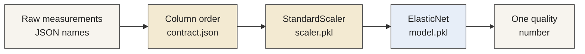
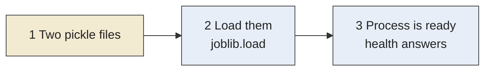
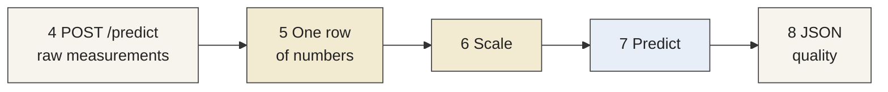
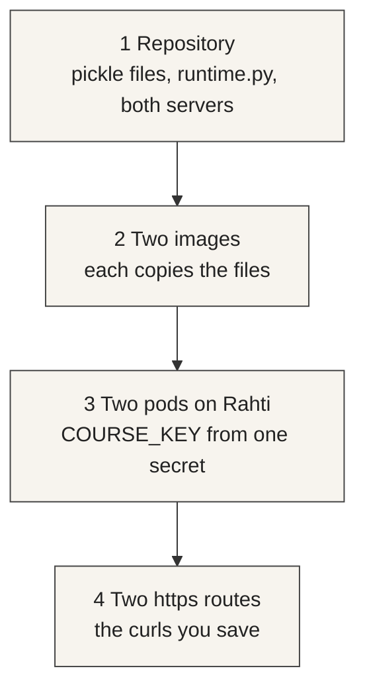

# Exercise 3

Model deployment — 20 points

Session {{ site.session_5_date }}. Deadline {{ site.exercise_3_deadline }}.

Exercise 2's prompt change is due the same evening.

---

## Learning focus

- A saved model and the preprocess step that has to travel with it
- Load once, then score each request
- An application server and a serving framework around one wrapper
- A prediction route a later tool can call

---

## From a training run to a service

Exercise 1 ran a pipeline. It scaled the laboratory columns, fit an ElasticNet, and stored metrics in MLflow. When that run finished, the pipeline stopped.

A deployed model is the saved result of a run, kept available so a new measurement can be scored without training again.

The service loads the files when the process starts and then waits. Each prediction is one request.

---

## What was saved

`model/model.pkl` holds the fitted ElasticNet. It maps one row of numbers to one quality number.

`model/scaler.pkl` holds the means and the scales from training.

A prediction repeats both steps, in that order: scale the raw numbers, then call `predict`.

---

## Your own week 2 run

The two files in the template are a stand-in. Replace both with the files from your own week 2 run, before you changed the pipeline.

Kubeflow and MLflow list every student's runs together. Open yours by the git commit of that push.

The Kubeflow run name ends with your `exercise-1-<id>` branch and the first 7 characters of that commit. In MLflow the same commit is the parameter `git_commit_hash`.

Copy the scaling file from the preprocess step and the model file from the train step of that same run. The week 3 run is not the pair you deploy.

The servers install scikit-learn 1.0.2, the version that saved those files.

---

## Why these files are in git

A model file is often too large to keep in a git repository. MLflow stores those files in separate storage, such as S3, and the commit only records which run produced them.

These two files are small, so this exercise commits them. The branch can then be built as it is, and the committed files can be compared with the run that saved them.

---

## One score



---

## How a score is made

The first path runs when the process starts. The second path runs for each request.

**When the process starts**



**For each request**



---

## Two ways to publish the same wrapper

The scoring steps live in `runtime.py`. Both servers call that file.

FastAPI is the application server you can read. It declares `GET /health` and `POST /predict`.

BentoML is a serving framework. It publishes `POST /predict` from the `predict` method, and its own probe is `GET /healthz`.

The same request should get the same quality number from both, because both loaded the same two files.

---

## Where the steps live



Leave the FastAPI deployment running. Exercise 4 calls it inside the project.

---

## What you fill in

Clone {{ site.exercise_3_repo_name }}. Create `exercise-3-<id>` from {{ site.exercise_3_base_branch }}. Do not commit on {{ site.exercise_3_base_branch }}.

Four functions in `runtime.py` still raise `NotImplementedError`:

1. `load_artifacts` loads both pickle files when the process starts
2. `features_in_order` builds one row in `contract.json` order
3. `quality_from_row` scales that row and returns one float
4. `require_course_key` compares `X-Course-Key` with `COURSE_KEY`

---

## The key

Choose a key you do not use anywhere else.

Store it in the Rahti secret `exercise-3-access` before the deployments are applied.

Email that same key to {{ site.email }}. Subject: `For exercise 3 check`.

Do not commit the key. Health stays open. `POST /predict` without the header is rejected.

---

## Deploy and compare

Same Rahti project as Exercise 2. The builds are local uploads:

```bash
oc start-build exercise-3-fastapi --from-dir=. --follow
oc start-build exercise-3-bentoml --from-dir=. --follow
```

A push checks the branch. It does not deploy.

Send `request.json` to both routes with the header. Save both bodies. The quality numbers should match.

---

## Files to commit

| File | What it contains |
| --- | --- |
| `model/scaler.pkl` | The scaling file from your week 2 run |
| `model/model.pkl` | The model file from that same run |
| `runtime.py` | The four functions filled in |
| `deployment.txt` | Both `https` addresses, no path |
| `response-fastapi.json` | The FastAPI prediction |
| `response-bentoml.json` | The BentoML prediction |
| `comparison.md` | Both quality numbers |

---

## Grading

| Criterion | Points |
| --- | ---: |
| Model artifact available | 3 |
| Deployment configuration completed | 5 |
| Model successfully deployed | 5 |
| Successful prediction request | 4 |
| Successful prediction response | 3 |
| Total | 20 |

The artifact points require both files from your own week 2 run. The request and response points require both routes to return the score those committed files produce for `request.json`.
