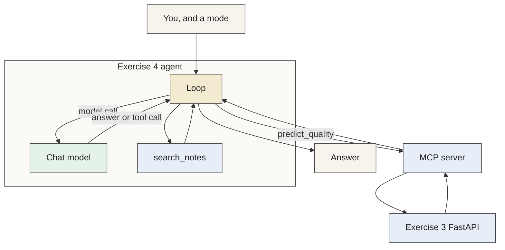
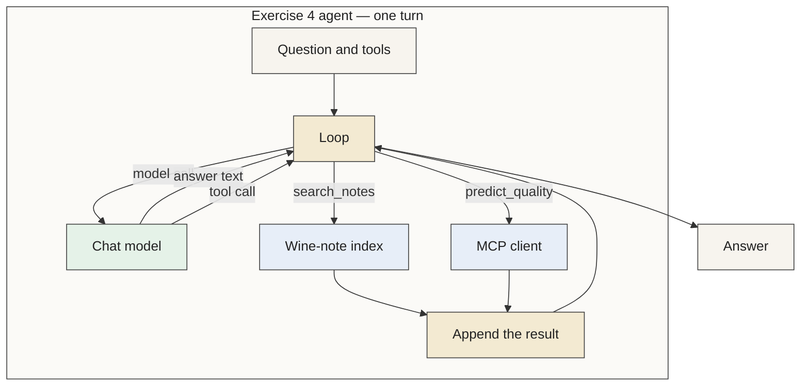

# Exercise 4

GenAI and ML integration — 20 points

Session {{ site.session_6_date }}. Deadline {{ site.exercise_4_deadline }}.

Exercise 5, the team application, is on the following two weeks.

---

## Learning focus

- A loop that calls the chat model, and can call it again
- A mode as the set of tools offered on one turn
- The tool result sent back before the next model call
- A scope rule in the system prompt
- One MCP tool in front of the Exercise 3 prediction service

---

## A fixed path, then a loop

Exercise 2 takes the same steps for every question. The application retrieves the notes, writes them into one prompt, and the model writes the text.

This exercise is an agent. The agent is the application around the chat model.

That application comprises what can nowadays be called an agent harness: the loop, the mode table, the scope rule, and the quality tool. The model can only take a step the harness offers, and it never sees the course key.

A loop inside it calls the model with the question and the tools for the selected mode.

The model returns answer text, or a tool call. On a tool call the loop runs the tool and calls the model again. The loop stops after four model calls.

Exercise 2 stays deployed. This is a new application.

---

## Inside the agent

- The loop offers this mode's tools and counts the model calls
- The chat model returns the answer text or a tool call
- `search_notes` reads the wine-note index in this process

`predict_quality` leaves the agent. An MCP server calls the Exercise 3 FastAPI service and sends `X-Course-Key`. The loop never sees the key.

---

## Path

The loop, the model call, and `search_notes` are inside the agent. The MCP server is outside, and it sends `X-Course-Key`. The loop never sees the key.

---

## One turn

The model call returns to the loop. The loop runs `search_notes` here, or calls MCP. The template records the result and does not send it back. That append is yours.

---

## Leave these running

The Exercise 2 assistant.

The Exercise 3 FastAPI service, at `http://exercise-3-fastapi:8000` inside the project.

BentoML is not on this path. Scale it to zero only if the project cannot schedule another pod.

---

## Four modes

The mode chooses which tools the loop offers. The model decides whether to call a tool it was offered.

| Mode | Offered |
| --- | --- |
| Notes | Wine notes |
| Estimate | Quality tool |
| Both | Notes and quality tool |
| Model alone | Nothing |

---

## Why four trials

Notes. A source the answer can cite.

Estimate. A tool for a quantity. The number comes from the deployed model.

Both. A question that needs the citation and the number.

Model alone. No tools, and a question outside the study. Your scope rule makes the assistant decline instead of advising.

You write the four prompts. The page describes the situation and does not give the sentence.

---

## What you record

For each mode: the prompt, the tool trace, the answer, and a short comment.

Notes retrieves a note and does not estimate.

Estimate returns a quality number and cites no note.

Both uses a note and that number.

Model alone has an empty tool trace and a refusal.

---

## What you edit

`api/routers/agent.py`

- Fill `MODES`. Notes, Estimate, Both, and an empty Model alone.
- In `run_turn`, send the tool result back as a tool message.
- Write `SCOPE_RULE` in your own words. Stay on this study. Decline the rest.

`mcp_server/predict_quality.py`

- Fill the input schema with the eleven names from `contract.json`.
- Replace the handler with `POST /predict`. Return `quality`.

---

## What you do not rebuild

The chat page, the note index, and the mode switch are in the template.

Same chat model and same embedding model as Exercise 2.

Same Rahti project. New deployments: `exercise-4-web`, `exercise-4-agent`, `exercise-4-mcp`.

---

## Stack

Kept from Exercise 2: Next.js, FastAPI, the wine notes, the in-memory index.

Added: a small MCP server in its own deployment. It does not load the index.

You fill three places in the loop. You do not replace it. No agent framework in this repository.

Libraries for larger systems are on the extra reading page.

---

## Submit

Push `exercise-4-<id>`.

Commit `api/routers/agent.py`, the MCP file, `trials.md`, and `deployment.txt`.

Keep FastAPI running. Email the new chat password. Subject: `For exercise 4 check`.

A push checks the branch. It does not deploy and it does not call the model.

---

## Grading — 20 points

| Work | Points |
| --- | ---: |
| Modes | 3 |
| Tool result sent back | 3 |
| Scope rule | 3 |
| MCP schema | 3 |
| MCP handler | 3 |
| Number in the Estimate and Both answers | 3 |
| Four trials and the route | 2 |

---

## Guardrails

Without a scope rule the model answers anyway, and it can sound sure.

The rule in the system prompt is the bound for this exercise. The mode table is another: a tool that is not offered cannot be called.

The scope rule and the mode table are bounds of this agent harness. A library and an engine are larger arrangements of the same kind. Those are called harnesses too. The extra reading page says where.

---

## Code-based frameworks

A code library is an agent harness your program calls. You still write the application. The library owns the loop, the memory, and the tracing.

LangChain, LangGraph, LlamaIndex, CrewAI, Pydantic AI, the OpenAI Agents SDK, Google's Agent Development Kit, Semantic Kernel, smolagents.

MCP stays the tool interface. The specification and the Python SDK are on the reading page.

This exercise does not add those libraries.

---

## Engine-based agents

An engine is an agent harness that already runs, which you configure. The project supplies the configuration.

Instructions, skills, MCP servers, and hooks.

Claude Code, OpenCode, Codex CLI, and others.

You describe the job. You do not write the turn that calls the model and runs the tool.

---

## Configuration wizard

The GAIK solution wizard uses Claude Code as the engine.

`/solution-wizard` loads `implementation_layer/solution_wizard/SKILL.md`.

The skill talks to the user and drafts the blueprint. Python scripts check the blueprint and write the files. They do not converse.

Hooks are a separate configuration point. The toolkit's agent-plugin README shows where Claude Code reads skills, MCP, and hooks. The wizard itself is the skill, the registry, and the scripts.

Repository: `https://github.com/GAIK-project/gaik-toolkit`
